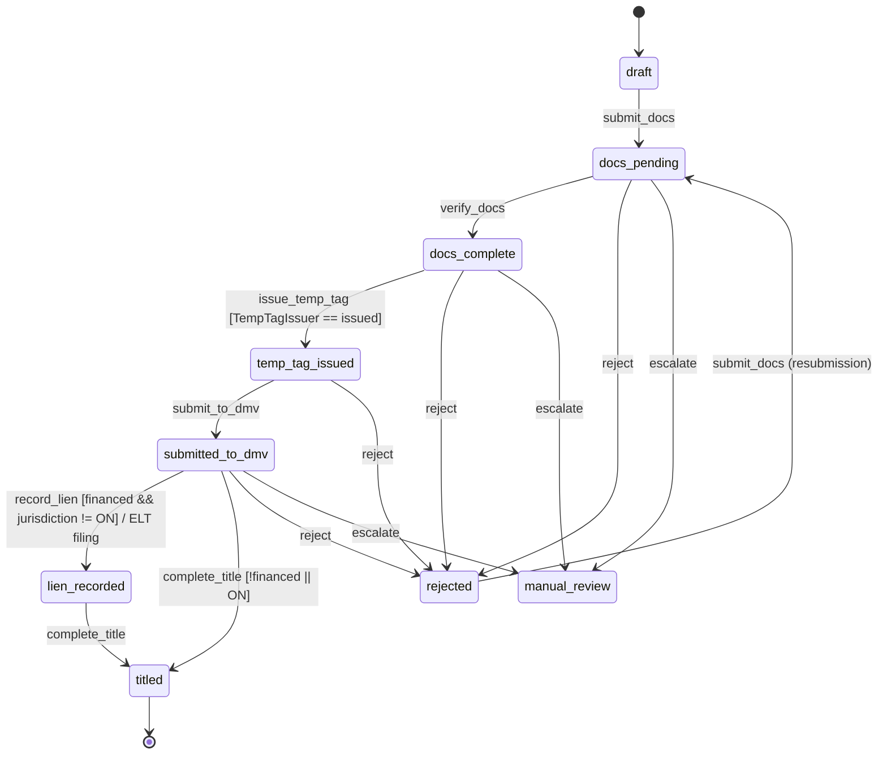

# Spec: Registration state machine & Temporary Tag Issuance (legacy behaviour)

> **Reference output of Step 1.** In the live demo, Devin regenerates this from `legacy/` and the result is diffed against this file.
> Every rule cites `file:line`. All values are **synthetic and illustrative, not legal guidance**.
> Status legend: ✅ confirmed by characterization test · ⚠️ `NEEDS-SME-REVIEW` (legacy quirk, behaviour preserved).

## 1. States and transitions
Source: `legacy/app/models/registration_state_machine.rb:4-13`

| Event | From | To | Guard / side effect | Source | Test |
|---|---|---|---|---|---|
| submit_docs | draft, rejected | docs_pending | none | `registration_state_machine.rb:5` | ✅ |
| verify_docs | docs_pending | docs_complete | none | `:6` | ✅ |
| issue_temp_tag | docs_complete | temp_tag_issued | `TempTagIssuer` must return `issued`, else raise and **state unchanged** | `:7`, `:35-38` | ✅ |
| submit_to_dmv | temp_tag_issued | submitted_to_dmv | none | `:8` | ✅ |
| record_lien | submitted_to_dmv | lien_recorded | financed only; **not allowed for ON**; after transition calls `Elt::LienFilingService#file!` | `:9`, `:40-43`, `:51-53` | ✅ |
| complete_title | submitted_to_dmv, lien_recorded | titled | financed non-ON requires `lien_recorded` | `:10`, `:45-49` | ✅ |
| reject | docs_pending … submitted_to_dmv | rejected | none | `:11` | ✅ |
| escalate | docs_pending, docs_complete, submitted_to_dmv | manual_review | **no code path leaves manual_review** | `:12` | ✅ ⚠️ Q-05 |

## 2. Temporary Tag Issuance (slice to port)
Source: `legacy/app/services/temp_tag_issuer.rb`

Evaluation order (it matters, because reasons are returned in this order):
1. VIN must match `^[A-HJ-NPR-Z0-9]{17}$`. If not, reject with **only** `invalid_vin` and evaluate nothing else (`temp_tag_issuer.rb:2,9`).
2. Rules are looked up by **registration** jurisdiction. Unknown codes fall through to default rules (`jurisdictions/base_rules.rb:16`).
3. Missing documents are reported in the jurisdiction's required order as `missing_document:<name>` (`temp_tag_issuer.rb:11`).
4. Lien errors are appended (`:12`), then jurisdiction extras (`:13`). Any error rejects (`:14`).
5. Expiry = `base_date + valid_days`, then the jurisdiction adjustment (`:16`).
6. Tag number = `<CODE>-` + first 8 hex chars of `SHA256("vin:jurisdiction:attempt")`, upper-cased (`:31-33`).

Input handling (affects the result even though no rule mentions it):
- `attempt` defaults to 1 only when it is missing or `null` (`@attempt ||= 1`, `registration.rb:11`). An explicit `0` is kept and goes into the tag hash as `:0`. Fixture `CA_attempt_zero`.
- `requested_at` is read with Ruby `Date.parse` (`registration.rb:24-26`). For an ISO date-time it keeps the calendar date **as written** and ignores the time and UTC offset (`2026-11-25T23:30:00-08:00` → `2026-11-25`). Fixture `CA_requested_at_datetime`. ⚠️ Q-07
- Blank-name checks use Ruby `String#strip` (`tx_rules.rb:16`), which removes only NUL, `\t`, `\n`, `\v`, `\f`, `\r` and space. A name of only U+00A0 counts as present; a name of only NUL counts as blank. Fixtures `TX_lienholder_name_nbsp`, `TX_lienholder_name_nul`. Verified on Ruby 3.0.2; confirm against the production Ruby version.

| Rule | CA | TX | ON | Default (any other) |
|---|---|---|---|---|
| Valid days | 90 (`ca_rules.rb:4`) | 60 (`tx_rules.rb:4`) | 10 (`on_rules.rb:6`) | 30 (`base_rules.rb:4`) |
| Fee | 0 USD | 500¢ USD (`tx_rules.rb:5`) | 3200¢ **CAD** (`on_rules.rb:7-8`) | 0 USD |
| Required docs | purchase_agreement, odometer_disclosure, + lien_agreement if financed (`ca_rules.rb:6-10`) | purchase_agreement, form_130u, + lien_agreement if financed (`tx_rules.rb:7-11`) | bill_of_sale, proof_of_insurance; **no lien doc even if financed** (`on_rules.rb:9`) | none |
| Lien rule | finance/lease needs lienholder **ELT id**, else `elt_lienholder_required` (`ca_rules.rb:12-16`) | finance/lease needs lienholder **name**, else `lienholder_required` (`tx_rules.rb:13-17`) | none; flags `ppsa_registration_required` (+ `lessor_owned` for lease) (`on_rules.rb:16-21`) | none |
| Extra check | none | none | postal code `^[A-Z]\d[A-Z] ?\d[A-Z]\d$`, **case-sensitive** (`on_rules.rb:3,11-14`) | none |
| Expiry adjustment | Sunday → Monday, flag `expiry_rolled_from_sunday` (`ca_rules.rb:20-22`) | none | none | none |
| Flags | none | `resubmission` if attempt > 1 (`tx_rules.rb:19-21`) | see lien rule | `unsupported_jurisdiction_default_rules` (`base_rules.rb:10`) |

## 3. Open questions for SMEs (behaviour preserved until answered)
| ID | Observation | Evidence | Risk | Fixture |
|---|---|---|---|---|
| Q-01 ⚠️ | **TX resubmission recomputes expiry from the new request date** and ignores `original_issued_at`, so a resubmitted tag gets a fresh 60 days | `tx_rules.rb:24-26` | Temp-tag validity extended beyond the statutory window | `TX_resubmission_recomputes_expiry` |
| Q-02 ⚠️ | **ELT lien filing retries timeouts up to 3× with no idempotency key** | `elt/lien_filing_service.rb:17-19` | Duplicate lien filings at the ELT provider | characterization spec "ELT lien filing" |
| Q-03 ⚠️ | **Unsupported jurisdiction (e.g. NY) silently gets 30-day default rules** with no document checks; `delivery_jurisdiction` is ignored entirely | `base_rules.rb:4-12,16` | Tag issued under the wrong rules; should probably be manual review | `AZ_delivery_NY_registration` |
| Q-04 ⚠️ | ON postal code check is case-sensitive: `m5v 3l9` is rejected | `on_rules.rb:3` | Avoidable rejections and delivery delay | `ON_lowercase_postal_rejected` |
| Q-05 ⚠️ | `manual_review` is a dead-end state: no transition leaves it | `registration_state_machine.rb:4-13` | Registrations stuck without an SLA | state-machine spec |
| Q-06 | Temp tags are not idempotent: a retry issues a new tag record (the deterministic tag number hides it) | `temp_tag_issuer.rb` (no persistence/key) | Duplicate records downstream | fixed in Go by design (ADR 0001) |
| Q-07 ⚠️ | `requested_at` date-times keep the local calendar date and drop the offset, so the same instant can expire on different days depending on how the caller formats it | `registration.rb:24-26` | Off-by-one expiry near midnight | `CA_requested_at_datetime` |
| Q-08 ⚠️ | `Date.parse` also accepts non-ISO formats (`2026/11/25`, `20261125`, `Nov 25 2026`, text around a date). The Go port accepts only ISO dates and ISO date-times and returns an error for the rest. Need to confirm what callers actually send | `registration.rb:25` | Go returns errors where legacy issued a tag | none (not ported) |

## 4. Sign-off
| Section | Owner | Signed |
|---|---|---|
| CA rules | DMV Ops (CA) | ☐ |
| TX rules | DMV Ops (TX) | ☐ |
| ON rules | DMV Ops (Canada) | ☐ |
| Q-01 … Q-08 decisions | DMV Ops + Legal | ☐ |
